<picture>
<source media="(max-width: 520px) and (prefers-color-scheme: dark)" srcset="assets/hero-mobile-dark.svg">
<source media="(max-width: 520px)" srcset="assets/hero-mobile-light.svg">
<source media="(prefers-color-scheme: dark)" srcset="assets/hero-dark.svg">
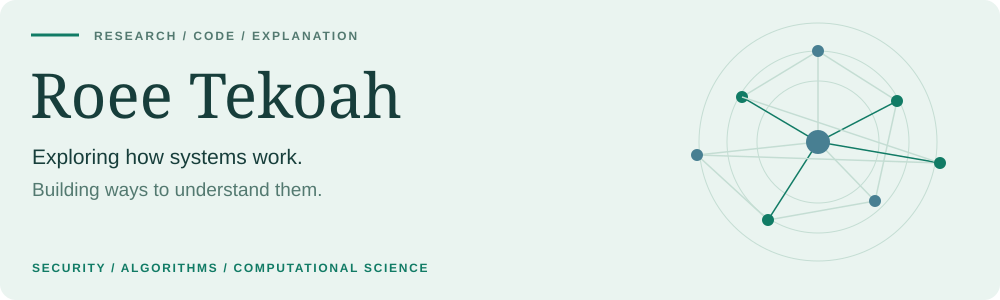
</picture>

<a href="assets/CV.pdf"><picture>
<source media="(prefers-color-scheme: dark)" srcset="assets/cv-dark.svg">

</picture></a>&nbsp;<a href="https://linkedin.com/in/roeet"><picture>
<source media="(prefers-color-scheme: dark)" srcset="assets/linkedin-dark.svg">

</picture></a>&nbsp;<a href="mailto:roeetekoah@gmail.com"><picture>
<source media="(prefers-color-scheme: dark)" srcset="assets/email-dark.svg">

</picture></a> 
Background: JSOF · Matzov · Mobileye · Raviv Research Group Computer Science B.Sc. @ the Hebrew University of Jerusalem.

<h2>↗ Research &amp; Computational Science</h2>
<table width="100%">
<tbody><tr><td width="34%" align="center" valign="middle"><picture>
<source media="(prefers-color-scheme: dark)" srcset="assets/dplus-dark.svg">
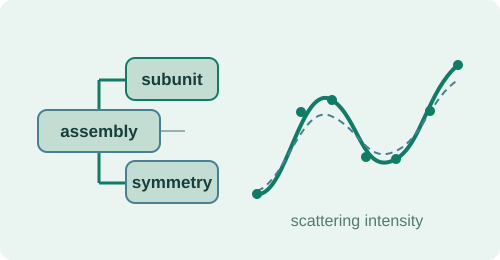
</picture></td><td valign="middle">
<strong><a href="https://github.com/uri-raviv-lab/dplus-dev">D+ · Hierarchical modeling of X-ray scattering</a></strong> An open-source platform for hierarchical structural modeling and high-performance solution-scattering calculations, with a coauthored paper in the Journal of Applied Crystallography.

C++ · Scientific computing · Coauthor, J. Appl. Cryst. (2019) <a href="https://github.com/uri-raviv-lab/dplus-dev">Explore software ↗</a> &nbsp;·&nbsp; <a href="https://pmc.ncbi.nlm.nih.gov/articles/PMC6495662/">Read the paper ↗</a>
</td></tr></tbody>
<tbody><tr><td width="34%" align="center" valign="middle"><picture>
<source media="(prefers-color-scheme: dark)" srcset="assets/xplus-dark.svg">
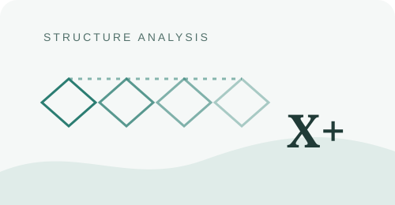
</picture></td><td valign="middle">
<strong><a href="https://github.com/uri-raviv-lab/dplus-dev/tree/development/X%2B">X+ · Supramolecular structure analysis</a></strong> A scientific-computing system for analyzing repeating structure in supramolecular assemblies.

C++ · C# · Geometry · Scientific computing <a href="https://github.com/uri-raviv-lab/dplus-dev/tree/development/X%2B">Explore X+ ↗</a>

My contributions across D+ and X+

Designed and implemented C++ algorithms for X-ray scattering analysis, including polymer-structure modules; developed a C# system that identifies repeating subunits through geometric transformations, achieving approximately 10× speedup at equal computational precision; and contributed to an octree-based algorithm for efficient protein hydration-shell identification.

</td></tr></tbody>
<tbody><tr><td width="34%" align="center" valign="middle"><picture>
<source media="(prefers-color-scheme: dark)" srcset="assets/salsa-landscape-dark.svg">
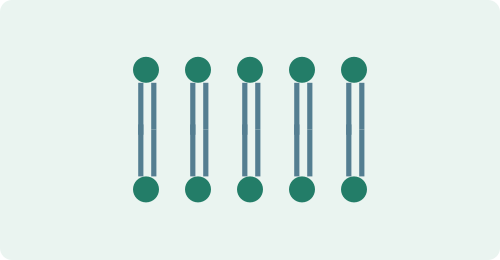
</picture></td><td valign="middle">
<strong><a href="https://github.com/roeetekoah/SaLSA">SaLSA · Salt–Lipid Scattering Analysis</a></strong> Investigating how five metal salts affect DPPC membrane organization and lamellar spacing using small-angle X-ray scattering.

SAXS · Experimental research · 2017–2018 <a href="https://github.com/roeetekoah/SaLSA">Explore repository ↗</a> &nbsp;·&nbsp; <a href="https://github.com/roeetekoah/SaLSA/blob/main/output/pdf/main.pdf">Read manuscript ↗</a>
</td></tr></tbody>
<tbody><tr><td width="34%" align="center" valign="middle"><picture>
<source media="(prefers-color-scheme: dark)" srcset="assets/graft-dark.svg">
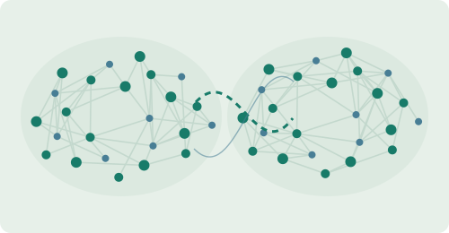
</picture></td><td valign="middle">
<strong><a href="https://github.com/roeetekoah/GraFT">GraFT</a></strong> Finding candidate gene-transfer signals in protein-similarity graphs.

Python · Graph algorithms  <a href="https://github.com/roeetekoah/GraFT">Explore repository ↗</a> &nbsp;·&nbsp; <a href="assets/graft-figure.png">Project figure ↗</a>
</td></tr></tbody>
<tbody><tr><td width="34%" align="center" valign="middle"><picture>
<source media="(prefers-color-scheme: dark)" srcset="assets/liver-dark.svg">
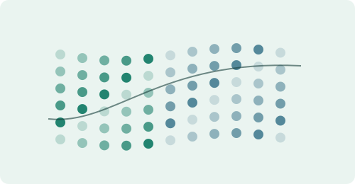
</picture></td><td valign="middle">
<strong><a href="https://github.com/roeetekoah/liver-zonation">LiZARD</a></strong> Donor-aware reanalysis of liver single-nucleus RNA evidence, testing zonation, sampling effects, and acquisition confounds in chronic disease.

Python / R · Statistical inference  <a href="https://github.com/roeetekoah/liver-zonation">Explore repository ↗</a> &nbsp;·&nbsp; <a href="assets/liver-schematic.png">Method illustration ↗</a>
</td></tr></tbody>
<tbody><tr><td width="34%" align="center" valign="middle"><picture>
<source media="(prefers-color-scheme: dark)" srcset="assets/quantum-dark.svg">
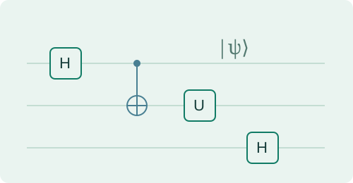
</picture></td><td valign="middle">
<strong><a href="https://github.com/roeetekoah/quantum-computation">Quantum Algorithms, Codes &amp; Circuit Complexity</a></strong> Local information in quantum codes, state-preparation lower bounds, finite-precision discrete logarithms, and quantum fingerprinting.

Advanced theoretical coursework  <a href="https://github.com/roeetekoah/quantum-computation/blob/main/pdfs/quantum-computation-project.pdf">Read the report ↗</a> &nbsp;·&nbsp; <a href="https://github.com/roeetekoah/quantum-computation/blob/main/pdfs/quantum-mean-estimation-review.pdf">Mean-estimation review ↗</a> &nbsp;·&nbsp; <a href="https://github.com/roeetekoah/quantum-computation">Repository ↗</a>
</td></tr></tbody>
</table>

<h2>⌘ Algorithms in practice</h2>

<table width="100%"><tr><td>
<a href="https://github.com/roeetekoah/video-mosaicing#video-mosaicing"><picture>
<source media="(prefers-color-scheme: dark)" srcset="assets/video-mosaicing-real-dark.png">
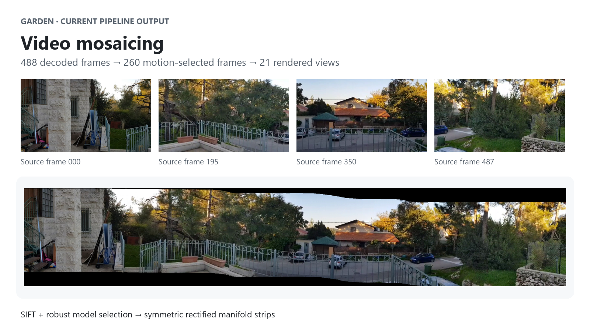
</picture></a>
<h3><a href="https://github.com/roeetekoah/video-mosaicing">Video mosaicing</a></h3>

Moving-viewpoint panoramas from a continuous camera scan, built on direct pyramidal Lucas–Kanade alignment, coordinated strip selection and seam blending. A depth-aware LK extension compensates local parallax in selected scenes; the published gallery uses the original rendering where it gives the better result.

Python · Computer vision 

<a href="https://github.com/roeetekoah/video-mosaicing#video-mosaicing">Watch the actual panorama sweep ↗</a> &nbsp;·&nbsp; <a href="https://github.com/roeetekoah/video-mosaicing/blob/main/docs/direct-lk.md">Method walkthrough ↗</a> &nbsp;·&nbsp; <a href="https://github.com/roeetekoah/video-mosaicing/blob/main/docs/direct-lk-evaluation.md">Per-video evaluation ↗</a> &nbsp;·&nbsp; <a href="assets/panorama.png">Original coursework panorama ↗</a>

</td></tr></table>

<table width="100%"><tr>
<td width="50%" valign="top">
<picture>
<source media="(prefers-color-scheme: dark)" srcset="assets/parsing-dark.svg">
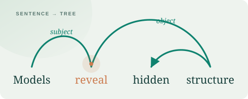
</picture>

<strong>Dependency parsing</strong> Learning sentence structure with maximum spanning trees and transformer attention features.

Python · NLP · Structured prediction  Preparing release
</td>
<td width="50%" valign="top">
<picture>
<source media="(prefers-color-scheme: dark)" srcset="assets/aligner-dark.svg">
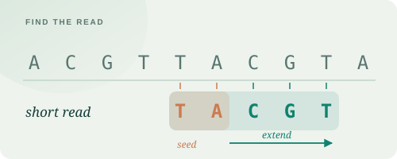
</picture>

<strong>Short-read aligner</strong> Seed-and-extend read mapping, with a reference implementation and benchmark experiments.

Python · Algorithms  Preparing release
</td>
</tr></table>

<table width="100%"><tr>
<td width="50%" valign="top">
<picture>
<source media="(prefers-color-scheme: dark)" srcset="assets/sjava-dark.svg">
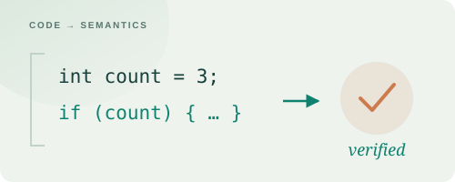
</picture>

<strong>Sjava verifier</strong> Scopes, types, and semantic checks for a restricted Java-like language.

Java · Software design  Preparing release
</td>
<td width="50%" valign="top">
<picture>
<source media="(prefers-color-scheme: dark)" srcset="assets/course-collections-card-dark.svg">
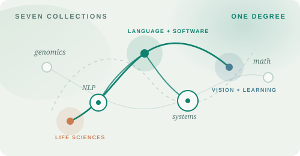
</picture>

<strong>Course collections</strong> Connected labs, reports, and notes across seven areas of the degree.

Algorithms · Experiments · Writing <a href="#-course-collections">Explore the collection plan ↓</a>
</td>
</tr></table>

<h2>▦ Course collections</h2>

<table width="100%">
<tr><td colspan="2" width="1100">
<strong>Seven course collections</strong> · Labs, reports, and notes connected across the degree. In preparation
</td></tr>
<tr><td width="120" align="center" valign="middle"><picture>
<source media="(prefers-color-scheme: dark)" srcset="assets/collection-life-dark.svg">
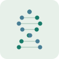
</picture></td><td valign="middle"><strong>Life sciences</strong> Computational biology · Genomics Sequence models, phylogenetic inference, sampling, and statistical analysis.</td></tr>
<tr><td width="120" align="center" valign="middle"><picture>
<source media="(prefers-color-scheme: dark)" srcset="assets/collection-language-dark.svg">

</picture></td><td valign="middle"><strong>Language &amp; software</strong> NLP · Object-oriented design · Databases Language models, semantic tools, software design, and query processing.</td></tr>
<tr><td width="120" align="center" valign="middle"><picture>
<source media="(prefers-color-scheme: dark)" srcset="assets/collection-vision-dark.svg">

</picture></td><td valign="middle"><strong>Vision &amp; learning</strong> Image processing · ML foundations Frequency methods, pyramids, blending, prediction, and optimization.</td></tr>
</table>
