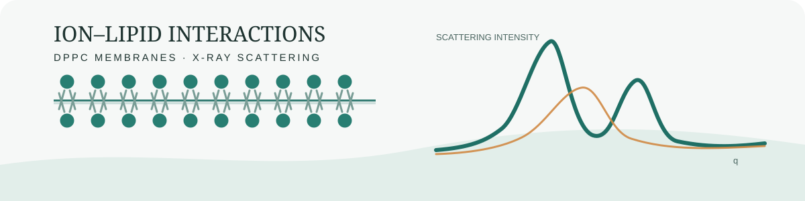
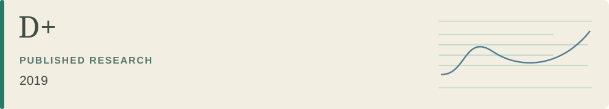
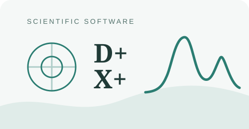

<picture>
<source media="(max-width: 520px) and (prefers-color-scheme: dark)" srcset="assets/hero-mobile-dark.svg">
<source media="(max-width: 520px)" srcset="assets/hero-mobile-light.svg">
<source media="(prefers-color-scheme: dark)" srcset="assets/hero-dark.svg">

</picture>

<a href="assets/CV.pdf"><picture>
<source media="(prefers-color-scheme: dark)" srcset="assets/cv-dark.svg">

</picture></a>
<a href="https://linkedin.com/in/roeet"><picture>
<source media="(prefers-color-scheme: dark)" srcset="assets/linkedin-dark.svg">

</picture></a>
<a href="mailto:roeetekoah@gmail.com"><picture>
<source media="(prefers-color-scheme: dark)" srcset="assets/email-dark.svg">

</picture></a>

Background: JSOF · Matzov · Mobileye · Raviv Research Group Computer Science at the Hebrew University of Jerusalem.

<h2>↗ Research &amp; writing</h2>

Research questions, computational work, and the writing that makes the evidence inspectable.

<table width="100%"><tr><td>
<picture>
<source media="(prefers-color-scheme: dark)" srcset="assets/dppc-research-dark.svg">

</picture>
<h3>Ion–lipid interactions in DPPC membranes</h3>

Experimental X-ray scattering analysis of calcium binding, membrane structure, and osmotic stress, with an unpublished paper draft and extensive supporting data under release review.

Research case study · MATLAB / Python · Unpublished manuscript

Private · preparing a rights-cleared public edition

</td></tr></table>

<table width="100%">
<tr><td width="31%" valign="middle"><picture>
<source media="(prefers-color-scheme: dark)" srcset="assets/dplus-paper-dark.svg">

</picture></td><td width="69%" valign="top">
<h3><a href="https://doi.org/10.1107/S1600576718018046">D+ · Hierarchical modeling of X-ray scattering</a></h3>

<strong>Coauthor</strong> · <em>Journal of Applied Crystallography</em> · 2019

Hierarchical structural modeling and efficient computation of solution-scattering curves, with numerical validation and an application to microtubules.

<a href="https://pmc.ncbi.nlm.nih.gov/articles/PMC6495662/">Read the open-access paper ↗</a> &nbsp;·&nbsp; <a href="https://doi.org/10.1107/S1600576718018046">Publication record ↗</a>

</td></tr>
<tr><td width="19%" align="center" valign="top"><picture>
<source media="(prefers-color-scheme: dark)" srcset="assets/writing-quantum-dark.svg">

</picture></td><td valign="top">
<h3><a href="https://github.com/roeetekoah/quantum-computation">Inside the Quantum project</a></h3>

Proofs, a research-paper review, and a coursebook draft.

Explore the writing

<strong>Final Project — Part I</strong> covers deferred measurements, quantum codes, circuit depth, discrete logarithms, and fingerprinting. A separate paper review and sixteen-chapter coursebook draft provide further reading.

Mathematical writing · Public working edition

<a href="https://github.com/roeetekoah/quantum-computation">Explore repository ↗</a>

</td></tr>
</table>

<h2>◈ Selected work</h2>

Research software and academic projects I can share; my broader professional experience is in the CV.

<table width="100%">
<tr><td width="31%" valign="middle"><picture>
<source media="(prefers-color-scheme: dark)" srcset="assets/dplus-xplus-card-dark.svg">

</picture></td><td width="69%" valign="top"><h3>D+ / X+ scientific software</h3>

Modeling solution X-ray scattering in the Raviv Research Group.

I developed C++ analysis algorithms and polymer modules, built a C# repeating-subunit detector, and contributed to an octree-based protein hydration-shell algorithm.

C++ · C# · Scientific computing

<a href="https://github.com/uri-raviv-lab/dplus-dev">D+ repository ↗</a> &nbsp;·&nbsp; <a href="https://github.com/uri-raviv-lab/dplus-dev/tree/development/X%2B">X+ code ↗</a>
</td></tr>

<tr><td width="31%" valign="middle"><picture>
<source media="(prefers-color-scheme: dark)" srcset="assets/graft-dark.svg">

</picture></td><td width="69%" valign="top"><h3>GraFT</h3>

Finding candidate gene-transfer signals in protein-similarity graphs.

Python · Graph algorithms · Course-project grade: 100/100

<a href="https://github.com/roeetekoah/GraFT">Explore repository ↗</a> &nbsp;·&nbsp; <a href="assets/graft-figure.png">Project figure ↗</a>
</td></tr>

<tr><td width="31%" valign="middle"><picture>
<source media="(prefers-color-scheme: dark)" srcset="assets/liver-dark.svg">

</picture></td><td width="69%" valign="top"><h3>LiZARD</h3>

<strong>Liver Zonation Analysis, Robustness &amp; Donor effects:</strong> a donor-aware computational reanalysis of single-nucleus RNA evidence, sampling effects, and acquisition confounds in chronic disease.

Python / R · Statistical inference · Course-project grade: 96/100

<a href="https://github.com/roeetekoah/liver-zonation">Explore repository ↗</a> &nbsp;·&nbsp; <a href="assets/liver-schematic.png">Method illustration ↗</a>
</td></tr>

<tr><td width="31%" valign="middle"><picture>
<source media="(prefers-color-scheme: dark)" srcset="assets/quantum-dark.svg">

</picture></td><td width="69%" valign="top"><h3>Quantum computation</h3>

Proofs, quantum algorithms, and a research-paper review, with a sixteen-chapter coursebook draft.

Quantum algorithms · Mathematical writing

<a href="https://github.com/roeetekoah/quantum-computation">Explore repository ↗</a>
</td></tr>
</table>

<h2>⌘ Algorithms in practice</h2>

<table width="100%"><tr><td>
<a href="https://github.com/roeetekoah/video-mosaicing#video-mosaicing"><picture>
<source media="(prefers-color-scheme: dark)" srcset="assets/video-mosaicing-real-dark.png">

</picture></a>
<h3>Video mosaicing</h3>

The Garden example shows the original rigid Lucas–Kanade pipeline: 488 decoded frames, 80 registered samples, and 100 panorama views. The current release adds robust feature-based registration and locally rectified manifold strips.

Python · Computer vision · Original coursework grade: 100/100

<a href="https://github.com/roeetekoah/video-mosaicing">Explore the project ↗</a> &nbsp;·&nbsp; <a href="https://github.com/roeetekoah/video-mosaicing/blob/main/docs/pipeline-walkthrough.md">Algorithm walkthrough ↗</a> &nbsp;·&nbsp; <a href="https://github.com/roeetekoah/video-mosaicing/blob/main/docs/evaluation.md">Per-video evaluation ↗</a> &nbsp;·&nbsp; <a href="assets/panorama.png">Original coursework panorama ↗</a>

</td></tr></table>

<table width="100%"><tr>
<td width="50%" valign="top"><picture>
<source media="(prefers-color-scheme: dark)" srcset="assets/parsing-dark.svg">

</picture><h3>Dependency parsing</h3>

Learning sentence structure with maximum spanning trees and transformer attention features.

Python · NLP · Structured prediction

Preparing release
</td>

<td width="50%" valign="top"><picture>
<source media="(prefers-color-scheme: dark)" srcset="assets/aligner-dark.svg">

</picture><h3>Short-read aligner</h3>

Seed-and-extend read mapping, with a reference implementation and benchmark experiments.

Python · Algorithms · Course-project grade: 100/100

Preparing release
</td>
</tr></table>

<table width="100%"><tr>
<td width="50%" valign="top"><picture>
<source media="(prefers-color-scheme: dark)" srcset="assets/sjava-dark.svg">

</picture><h3>Sjava verifier</h3>

Scopes, types, and semantic checks for a restricted Java-like language.

Java · Software design

Preparing release
</td>

<td width="50%" valign="top"><picture>
<source media="(prefers-color-scheme: dark)" srcset="assets/collection-language-dark.svg">

</picture><h3>Course collections</h3>

Connected labs, reports, and notes across seven areas of the degree.

Algorithms · Experiments · Explanatory writing

<a href="#course-collections">Explore the collection plan ↓</a>
</td>
</tr></table>

<h2>▦ Course collections</h2>

Seven collections · in preparation

<table width="100%">
<tr><td width="18%" align="center" valign="middle"><picture>
<source media="(prefers-color-scheme: dark)" srcset="assets/collection-life-dark.svg">

</picture></td><td valign="middle"><strong>Life sciences</strong> Computational biology · Genomics Sequence models, phylogenetic inference, sampling, and statistical analysis.</td></tr>
<tr><td width="18%" align="center" valign="middle"><picture>
<source media="(prefers-color-scheme: dark)" srcset="assets/collection-language-dark.svg">

</picture></td><td valign="middle"><strong>Language &amp; software</strong> NLP · Object-oriented design · Databases Language models, semantic tools, software design, and query processing.</td></tr>
<tr><td width="18%" align="center" valign="middle"><picture>
<source media="(prefers-color-scheme: dark)" srcset="assets/collection-vision-dark.svg">

</picture></td><td valign="middle"><strong>Vision &amp; learning</strong> Image processing · ML foundations Frequency methods, pyramids, blending, prediction, and optimization.</td></tr>
</table>

The video-mosaicing showcase uses genuine source frames and genuine pipeline output from Garden.mp4. Other project artwork is conceptual; linked project figures are original artifacts.

