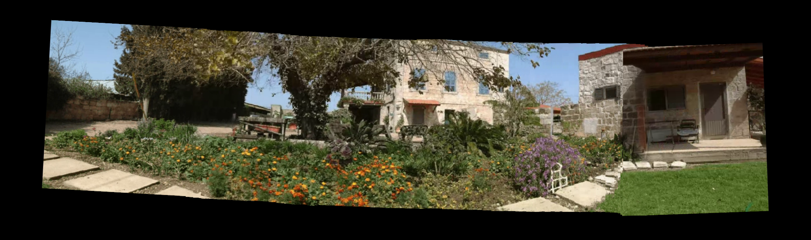

<picture>
<source media="(max-width: 520px) and (prefers-color-scheme: dark)" srcset="assets/hero-mobile-dark.svg">
<source media="(max-width: 520px)" srcset="assets/hero-mobile-light.svg">
<source media="(prefers-color-scheme: dark)" srcset="assets/hero-dark.svg">

</picture>

<a href="assets/CV.pdf"><picture>
<source media="(prefers-color-scheme: dark)" srcset="assets/cv-dark.svg">

</picture></a>
<a href="https://linkedin.com/in/roeet"><picture>
<source media="(prefers-color-scheme: dark)" srcset="assets/linkedin-dark.svg">

</picture></a>
<a href="mailto:roeetekoah@gmail.com"><picture>
<source media="(prefers-color-scheme: dark)" srcset="assets/email-dark.svg">

</picture></a>

Background: JSOF · Matzov · Mobileye · Raviv Research Group Computer Science at the Hebrew University of Jerusalem.

<h2>◈ Selected public work</h2>

Academic and independent projects I can share; my broader professional experience is in the CV.

<table width="100%">

<tr><td width="31%" valign="middle"><picture>
<source media="(prefers-color-scheme: dark)" srcset="assets/graft-dark.svg">

</picture></td><td width="69%" valign="top"><h3>GraFT</h3>

Finding candidate gene-transfer signals in protein-similarity graphs.

Python · Graph algorithms

<a href="https://github.com/roeetekoah/GraFT">Explore repository ↗</a> &nbsp;·&nbsp; <a href="assets/graft-figure.png">Project figure ↗</a>
</td></tr>

<tr><td width="31%" valign="middle"><picture>
<source media="(prefers-color-scheme: dark)" srcset="assets/liver-dark.svg">

</picture></td><td width="69%" valign="top"><h3>Liver zonation</h3>

Investigating spatial gene-expression patterns, confounding, and the limits of the evidence.

Python / R · Statistical inference

<a href="https://github.com/roeetekoah/liver-zonation">Explore repository ↗</a> &nbsp;·&nbsp; <a href="assets/liver-schematic.png">Method illustration ↗</a>
</td></tr>

<tr><td width="31%" valign="middle"><picture>
<source media="(prefers-color-scheme: dark)" srcset="assets/quantum-dark.svg">

</picture></td><td width="69%" valign="top"><h3>Quantum computation</h3>

Proofs, quantum algorithms, and a research-paper review, with a coursebook draft in development.

Quantum algorithms · Mathematical writing

Private · preparing release
</td></tr>

</table>

<h2>⌘ Algorithms in practice</h2>

<table width="100%"><tr><td><h3>Video mosaicing</h3>

From video frames to panoramas: registration, warping, and compositing.

Python · Numerical methods

<a href="assets/panorama.png">Panorama output ↗</a> &nbsp;·&nbsp; Preparing release
</td></tr></table>

<table width="100%"><tr><td>
<picture>
<source media="(prefers-color-scheme: dark)" srcset="assets/parsing-dark.svg">

</picture>
<h3>Dependency parsing</h3>

Learning sentence structure with spanning trees and transformer attention features.

Python · NLP

Preparing release
</td></tr></table>

<table width="100%"><tr>

<td width="50%" valign="top"><picture>
<source media="(prefers-color-scheme: dark)" srcset="assets/aligner-dark.svg">

</picture><h3>Short-read aligner</h3>

Seed-and-extend read mapping, with a reference implementation and benchmark experiments.

Python · Algorithms

Preparing release
</td>

<td width="50%" valign="top"><picture>
<source media="(prefers-color-scheme: dark)" srcset="assets/sjava-dark.svg">

</picture><h3>Sjava verifier</h3>

Scopes, types, and semantic checks for a restricted Java-like language.

Java · Software design

Preparing release
</td>

</tr></table>

<h2>↗ Research &amp; writing</h2>

<strong><a href="https://doi.org/10.1107/S1600576718018046">D+ · Modeling structures through X-ray scattering</a></strong> Coauthor, <em>Journal of Applied Crystallography</em>, 2019. My contribution included C++ analysis algorithms.

<strong>Inside the Quantum project</strong> — proofs, a paper review, and a coursebook draft

<strong>Final Project — Part I</strong> covers deferred measurements, quantum codes, circuit depth, discrete logarithms, and fingerprinting. A separate paper review and a coursebook draft provide further reading.

The project is currently private while I prepare its public edition.

<h2>▦ Course collections</h2>

Seven collections · in preparation

<table width="100%">
<tr><td width="18%" align="center" valign="middle"><picture>
<source media="(prefers-color-scheme: dark)" srcset="assets/collection-life-dark.svg">

</picture></td><td valign="middle"><strong>Life sciences</strong> Computational biology · Genomics Sequence models, phylogenetic inference, sampling, and statistical analysis.</td></tr>
<tr><td width="18%" align="center" valign="middle"><picture>
<source media="(prefers-color-scheme: dark)" srcset="assets/collection-language-dark.svg">

</picture></td><td valign="middle"><strong>Language &amp; software</strong> NLP · Object-oriented design · Databases Language models, semantic tools, software design, and query processing.</td></tr>
<tr><td width="18%" align="center" valign="middle"><picture>
<source media="(prefers-color-scheme: dark)" srcset="assets/collection-vision-dark.svg">

</picture></td><td valign="middle"><strong>Vision &amp; learning</strong> Image processing · ML foundations Frequency methods, pyramids, blending, prediction, and optimization.</td></tr>
</table>

Project artwork is schematic. Linked figures and the panorama are original project artifacts.

